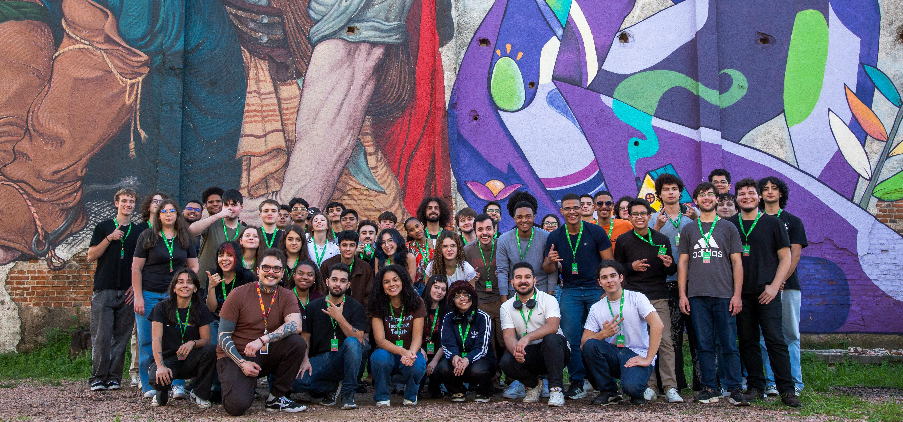

  

<h1 align="center">Geração Caldeira 2026 | IA & Dados</h1>

  Repositório de estudos, atividades e projetos desenvolvidos durante minha jornada no programa.

---

## Sobre o projeto

Este repositório reúne minha trajetória de aprendizado na trilha de **Inteligência Artificial & Dados**, no programa Geração Caldeira, do Instituto Caldeira.

O objetivo é documentar as atividades realizadas para representar os conhecimentos adquiridos ao longo da formação.

## Conteúdo

**Aulas e atividades**

(vou preencher isso aqui com as pastas quando terminar o gc)

**Projetos práticos**

(ainda vou preencher isso, por enquanto acho que virao para cá: desafio da fruki, sharktank, e n8n )

## Tecnologias e ferramentas

Algumas das tecnologias e ferramentas exploradas durante a formação:

- Python
- SQL
- FastAPI
- Git e GitHub
- Inteligência Artificial
- Análise e manipulação de dados
- n8n

## Projetos em destaque

| Projeto | Descrição |
|---|---|

| Desafio Fruki | Solução desenvolvida em equipe, integrando programação, IA e dados para agregar valor à operação da Fruki Bebidas. |

## Objetivos

- Consolidar conhecimentos em programação e análise de dados.
- Desenvolver soluções utilizando lógica e pensamento computacional.
- Explorar aplicações de inteligência artificial.
- Aprimorar boas práticas de desenvolvimento e versionamento.
- Construir projetos que conectem tecnologia a problemas reais.

---

  Geração Caldeira 2026 · Instituto Caldeira

